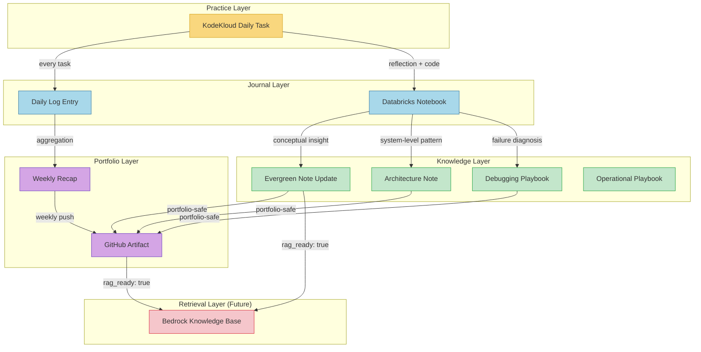
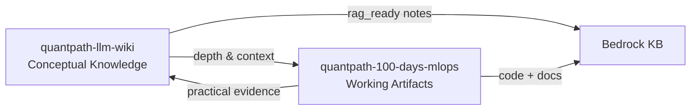

# MLOps Documentation Workflow

**Summary**: Operational bridge connecting daily KodeKloud 100 Days of MLOps practice to the existing evergreen note layer, Databricks engineering journals, GitHub portfolio artifacts, and future RAG ingestion — within the QuantPath Learning OS.

**Type**: Workflow / process document
**Status**: Active
**Visibility**: PORTFOLIO_SAFE
**Last updated**: 2026-05-27

---

## 1. Purpose of This Workflow

This document answers one question: **How does raw daily practice become durable, portfolio-ready, machine-retrievable knowledge?**

The QuantPath MLOps Knowledge Infrastructure already has:
- Seven evergreen notes in `07-mlops/evergreen/`
- Folder structure for architecture, debugging, playbooks, workflows, and glossary
- Vault practices defined in [[vault-practices]]
- A knowledge map in [[moc-mlops]]
- Templates for daily journals and weekly recaps in `_templates/`

What was missing: a **workflow bridge** — the explicit, repeatable process for routing daily KodeKloud work through each layer so nothing falls through the cracks and nothing gets over-documented.

This workflow ensures:
1. Every KodeKloud day produces *at minimum* a traceable log entry
2. High-signal work escalates to the appropriate knowledge layer
3. Databricks notebooks connect bidirectionally to Obsidian notes
4. GitHub artifacts link back to their conceptual roots
5. All output is structured for future RAG ingestion into a Bedrock Knowledge Base

---

## 2. Current Evergreen Note Layer

The following evergreen notes already exist in `07-mlops/evergreen/` and serve as the conceptual foundation for all MLOps documentation:

| Note | Domain | Connection to KodeKloud |
|------|--------|------------------------|
| [[mlflow-model-registry]] | Model Management | Model versioning, experiment tracking labs |
| [[docker-layer-caching]] | Infrastructure | Docker/container labs, CI/CD optimization |
| [[feature-store-patterns]] | Data/Features | Feature engineering, training-serving consistency |
| [[ci-cd-for-ml]] | Delivery | Pipeline automation, GitOps, deployment labs |
| [[kubeflow-pipelines]] | Orchestration | Kubernetes, pipeline orchestration labs |
| [[model-drift-monitoring]] | Operations | Monitoring, alerting, model performance labs |
| [[observability-for-ml-systems]] | Operations | Logging, metrics, distributed tracing labs |

**Rule**: These notes are *updated*, never recreated. When a KodeKloud task produces an insight relevant to an existing evergreen note, add to it — don't create a parallel note.

---

## 3. KodeKloud → Databricks → Obsidian → GitHub → RAG Pipeline

### Layer Definitions

| Layer | Platform | Purpose | Output Type |
|-------|----------|---------|-------------|
| **Practice** | KodeKloud 100 Days of MLOps | Hands-on task execution | Completed labs, CLI output, configs |
| **Journal** | Databricks Student Edition | Structured reflection and experimentation | Timestamped notebooks, code experiments |
| **Knowledge** | Obsidian (this vault) | Evergreen concepts, architecture, debugging | Atomic linked notes |
| **Portfolio** | GitHub | Public demonstration of competence | Commits, PRs, project documentation |
| **Retrieval** | Bedrock Knowledge Base (future) | Machine-searchable knowledge | Vector embeddings, semantic chunks |

### Flow Direction

```
Practice (KodeKloud)
    ↓ raw output
Journal (Databricks)
    ↓ structured reflection
Knowledge (Obsidian)
    ↓ polished artifacts
Portfolio (GitHub)
    ↓ ingestion pipeline
Retrieval (Bedrock RAG)
```

### What Flows Between Layers

| Transition | What Moves | What Stays Behind |
|------------|-----------|-------------------|
| KodeKloud → Databricks | Concepts, code snippets, error patterns | Platform-specific UI interactions |
| Databricks → Obsidian | Principles, failure modes, connections | Raw experiment logs, scratch work |
| Obsidian → GitHub | Portfolio-safe notes, architecture docs | Internal learning context, drafts |
| GitHub → RAG | All `rag_ready: true` content | Private notes, incomplete drafts |

---

## 4. Documentation Pipeline Diagram



---

## 5. Daily Workflow Checklist

Execute this after completing each KodeKloud 100 Days of MLOps task:

### Immediate (same session — 5 min)

- [ ] Create daily log entry using `_templates/databricks-mlops-daily-journal-template.md`
- [ ] Record: day number, topic, one-line objective, tools used, status
- [ ] Capture any error messages or debugging steps verbatim

### Reflection (within 2 hours — 10 min)

- [ ] Open Databricks notebook for today's work
- [ ] Write 2-3 sentence reflection: what concept was demonstrated? what would break in production?
- [ ] Add code snippets with annotations (not raw CLI dumps)
- [ ] Tag with relevant concepts: which evergreen notes does this touch?

### Escalation Decision (end of day — 5 min)

- [ ] Apply escalation criteria (Section 7 below)
- [ ] If escalating: create or update the target note immediately (don't defer)
- [ ] Update `[[wikilink]]` connections in both directions
- [ ] Set `rag_ready: true` if the note is self-contained and portfolio-safe

### Filing

- [ ] Daily log → `07-mlops/daily-log/day-NNN-topic.md` (create folder if needed)
- [ ] Databricks notebook → `06-databricks-labs/mlops/` (create subfolder if needed)
- [ ] Evergreen update → `07-mlops/evergreen/existing-note.md`
- [ ] New note → appropriate subfolder under `07-mlops/`

---

## 6. Weekly Recap Workflow

Execute every Sunday or Monday using `_templates/mlops-weekly-recap-template.md`:

### Input Gathering

1. Review all daily log entries from the past 7 days
2. Scan Databricks notebooks created/modified this week
3. Check GitHub commit history for the week
4. Review which evergreen notes were created or updated

### Synthesis

1. Identify the **top 3 concepts** learned (not tasks completed)
2. Document recurring failure patterns — these often become debugging playbooks
3. Note any architecture-level insights that emerged across multiple days
4. Extract reusable MLOps principles (transferable beyond this specific program)

### Output

1. Complete the weekly recap template
2. Push recap to GitHub (weekly commit cadence minimum)
3. Update [[moc-mlops]] if new notes were created
4. Identify next-week focus areas

### Portfolio Check

Ask: *"If a hiring manager read only this week's output, what skill would they see demonstrated?"*

If the answer is unclear, the week's documentation needs strengthening.

---

## 7. Escalation Rules — When a KodeKloud Task Becomes...

### Daily Log (always — every task)

**Trigger**: Task completed.
**No exceptions.** Every day gets a log entry, even if it was trivial.

**Content**: Day number, topic, one-line summary, tools, status, time spent.
**Location**: `07-mlops/daily-log/day-NNN-topic.md`

---

### Evergreen Note Update (concept is reusable and already has a home)

**Trigger** — ANY of these:
- The task directly relates to an existing evergreen note
- You learned something non-obvious about a concept already documented
- The task revealed a new failure mode for an existing concept
- You discovered a new AWS/Databricks equivalent worth recording

**Action**: Update the existing note. Add to the relevant section. Do NOT create a duplicate note.

**Examples**:
- Docker multi-stage build lab → update [[docker-layer-caching]] with new optimization pattern
- MLflow experiment tracking lab → update [[mlflow-model-registry]] with tracking-to-registry workflow
- Prometheus alerting lab → update [[observability-for-ml-systems]] with alerting patterns

---

### New Evergreen Note (concept is reusable but has no home yet)

**Trigger** — ALL of these must be true:
- The concept does not fit into any existing evergreen note
- The concept will be referenced by 2+ other notes
- The concept is durable (still relevant in 6 months)
- The concept connects to the QuantPath stack (AWS, Databricks, or ML)

**Action**: Create a new note in the appropriate subfolder using the standard structure from [[vault-practices]].

**Location**: Typically `07-mlops/evergreen/` unless it's clearly architecture, debugging, or infrastructure.

---

### Architecture Note (system-level design)

**Trigger** — ANY of these:
- The task involved designing or reasoning about a system with 3+ interacting components
- You made a trade-off decision (cost vs. latency, complexity vs. flexibility)
- The pattern applies across multiple projects or could inform QuantPath architecture
- A diagram is necessary to explain the relationship correctly

**Action**: Create note in `07-mlops/architecture/`

**Examples**:
- Kubernetes pod scheduling for ML inference → `gpu-scheduling-strategies.md`
- CI/CD pipeline with model validation gates → `ml-deployment-pipeline-architecture.md`
- Feature computation in batch vs. streaming → `feature-computation-architectures.md`

---

### Debugging Playbook (systematic diagnosis)

**Trigger** — ANY of these:
- You spent >15 minutes debugging a non-obvious issue
- The root cause was surprising or counter-intuitive
- The error message was misleading (fix differs from what the error implies)
- The same failure could recur in a different context or project

**Action**: Create note in `07-mlops/debugging/` with structure: Symptom → Investigation → Root Cause → Resolution → Prevention.

**Examples**:
- Container image builds failing silently → `debugging-silent-build-failures.md`
- Kubernetes pod stuck in CrashLoopBackOff → `debugging-crashloopbackoff.md`
- Model prediction mismatch between dev and prod → `debugging-training-serving-skew.md`

---

### GitHub Portfolio Artifact (public demonstration)

**Trigger** — ALL of these must be true:
- The work demonstrates a marketable skill
- The artifact is self-contained (understandable without vault context)
- The code runs or the documentation stands alone
- You would reference it in a job application or interview

**Action**: Push to GitHub. Link back to the originating note with a standard reference block.

**Examples**:
- Working CI/CD pipeline YAML → push to `quantpath-100-days-mlops` repo
- Architecture diagram with explanation → push as documentation
- Debugging playbook that demonstrates systematic thinking → push as portfolio piece

---

## 8. Linking Databricks Notebooks to Obsidian Notes

### From Databricks → Obsidian

In every Databricks notebook that produces conceptual insight, include a footer cell:

```markdown
## Vault References
- **Evergreen note**: [[concept-name]]
- **Daily log**: [[day-NNN-topic]]
- **Architecture**: [[system-name]] (if applicable)

## Metadata
- **Day**: NNN
- **KodeKloud topic**: Topic name
- **Escalated to**: evergreen / architecture / debugging / none
```

### From Obsidian → Databricks

In every evergreen note that was informed by a Databricks experiment, include a reference in the note body or the Related Notes section:

```markdown
## Databricks Sources
- `06-databricks-labs/mlops/day-NNN-experiment-name.md` — [brief description of what was tested]
```

### Cross-Reference Table (maintained in MOC)

Update [[moc-mlops]] periodically with a mapping table:

```markdown
## Databricks ↔ Evergreen Cross-Reference

| Databricks Notebook | Evergreen Note | Insight |
|---|---|---|
| day-005-docker-multistage | [[docker-layer-caching]] | Cache invalidation ordering |
| day-012-mlflow-tracking | [[mlflow-model-registry]] | Tracking → registry promotion |
```

---

## 9. Linking GitHub Portfolio Logs to Evergreen Notes

### GitHub → Obsidian (in commit messages and PR descriptions)

Use a consistent reference format in commit messages:

```
feat(mlops): add CI/CD pipeline for model validation

Vault ref: [[ci-cd-for-ml]], [[mlflow-model-registry]]
Day: 023
```

### Obsidian → GitHub (in note footer)

Every evergreen note that has produced a GitHub artifact should include:

```markdown
## GitHub Artifacts
- [quantpath-100-days-mlops/day-023-ci-pipeline](https://github.com/ChieNwosu/quantpath-100-days-mlops/tree/main/day-023-ci-pipeline) — Working CI/CD pipeline YAML
- [PR #15: Add model validation gate](https://github.com/ChieNwosu/quantpath-100-days-mlops/pull/15)
```

### Portfolio README Cross-Reference

The future `quantpath-100-days-mlops` repo README should include a "Knowledge Sources" section linking back to this vault's public-facing notes:

```markdown
## Knowledge Sources
Each day's work connects to conceptual documentation in the QuantPath LLM Wiki:
- [MLflow Model Registry](https://github.com/ChieNwosu/quantpath-llm-wiki/blob/master/07-mlops/evergreen/mlflow-model-registry.md)
- [Docker Layer Caching](https://github.com/ChieNwosu/quantpath-llm-wiki/blob/master/07-mlops/evergreen/docker-layer-caching.md)
- ...
```

---

## 10. How This Supports the QuantPath Learning OS

The QuantPath Learning OS is not a single project — it is a **knowledge operating system** that transforms learning inputs into career outputs. This MLOps documentation workflow plugs into the OS at multiple levels:

### Knowledge Graph Integration

```
QuantPath Learning OS
├── 02-ai-ml/          ← Foundational ML concepts
├── 03-data-sql/       ← Data engineering layer
├── 04-aws-cloud/      ← Cloud infrastructure
├── 05-quant-finance/  ← Domain application (mortgage rates)
├── 06-databricks-labs/ ← Engineering journal
├── 07-mlops/          ← THIS WORKFLOW lives here
│   ├── evergreen/     ← Durable concepts
│   ├── architecture/  ← System designs
│   ├── debugging/     ← Failure patterns
│   ├── playbooks/     ← Operational runbooks
│   └── workflows/     ← Process documentation
└── 08-career-dev/     ← Portfolio strategy
```

### Cross-Domain Value

MLOps knowledge connects to every other vault domain:
- **Quant Finance**: Model serving for rate prediction, pipeline orchestration for financial data
- **AWS Cloud**: Infrastructure implementation of MLOps concepts (SageMaker, Bedrock, Lambda)
- **Databricks**: Platform-specific MLOps patterns (Unity Catalog, MLflow, Delta Lake)
- **Data/SQL**: Upstream data quality that determines ML model quality
- **AI/ML**: Foundational concepts that MLOps operationalizes

### Career Narrative

The workflow produces a coherent story for technical reviewers:

> "I don't just learn MLOps concepts — I systematically document them as production-ready knowledge, connect them to cloud platforms, track my debugging patterns, and publish portfolio artifacts that demonstrate real competence."

This is the QuantPath™ differentiation: structured learning with visible, auditable output.

---

## 11. Next Steps — `quantpath-100-days-mlops` GitHub Repo

### Purpose

A **separate public repository** dedicated to the 100 Days of MLOps journey. The wiki vault holds conceptual knowledge; this repo holds working code, configurations, and day-by-day progress artifacts.

### Proposed Structure

```
quantpath-100-days-mlops/
├── README.md                    ← Program overview, progress tracker, skills demonstrated
├── PROGRESS.md                  ← Day-by-day completion log with links
├── days/
│   ├── day-001-topic/
│   │   ├── README.md            ← Task summary, learning, commands
│   │   ├── Dockerfile           ← Working artifact (if applicable)
│   │   ├── pipeline.yaml        ← CI/CD config (if applicable)
│   │   └── notes.md             ← Brief notes (links to wiki for depth)
│   ├── day-002-topic/
│   └── ...
├── projects/                    ← Multi-day projects that span several tasks
│   ├── ml-ci-pipeline/
│   └── model-serving-infra/
├── templates/                   ← Reusable configs, Dockerfiles, YAML templates
├── scripts/                     ← Utility scripts developed during the program
└── docs/
    ├── architecture/            ← Public architecture diagrams
    ├── knowledge-sources.md     ← Links to wiki evergreen notes
    └── tools-practiced.md       ← Comprehensive tools/skills inventory
```

### Creation Criteria

Create the repo when:
- [ ] Day 1 of KodeKloud 100 Days of MLOps is completed
- [ ] At least one working artifact exists (Dockerfile, YAML, script)
- [ ] README.md is drafted with program context and structure explanation
- [ ] First daily log is written in the wiki vault

### Repo Conventions

- **One folder per day** with a README explaining the task and outcome
- **Working code only** — no broken or placeholder files
- **Link to wiki** for conceptual depth (don't duplicate evergreen content)
- **Progress tracker** in PROGRESS.md updated with each push
- **Commit messages** reference wiki notes: `feat(day-005): docker multi-stage build [wiki: docker-layer-caching]`

### Relationship to This Vault



The wiki provides *why* and *when*. The repo provides *how* and *proof*.

---

## Related Notes

- [[moc-mlops]] — MLOps knowledge map and navigation hub
- [[vault-practices]] — Operational guide for vault maintenance
- [[mlflow-model-registry]] — Model versioning and governance
- [[docker-layer-caching]] — Container build optimization
- [[feature-store-patterns]] — Feature management patterns
- [[ci-cd-for-ml]] — CI/CD for ML systems
- [[kubeflow-pipelines]] — Pipeline orchestration
- [[model-drift-monitoring]] — Model degradation detection
- [[observability-for-ml-systems]] — Production ML monitoring
- [[dashboard]] — Vault-level command center
- [[quantpath-roadmap]] — Overall learning roadmap
