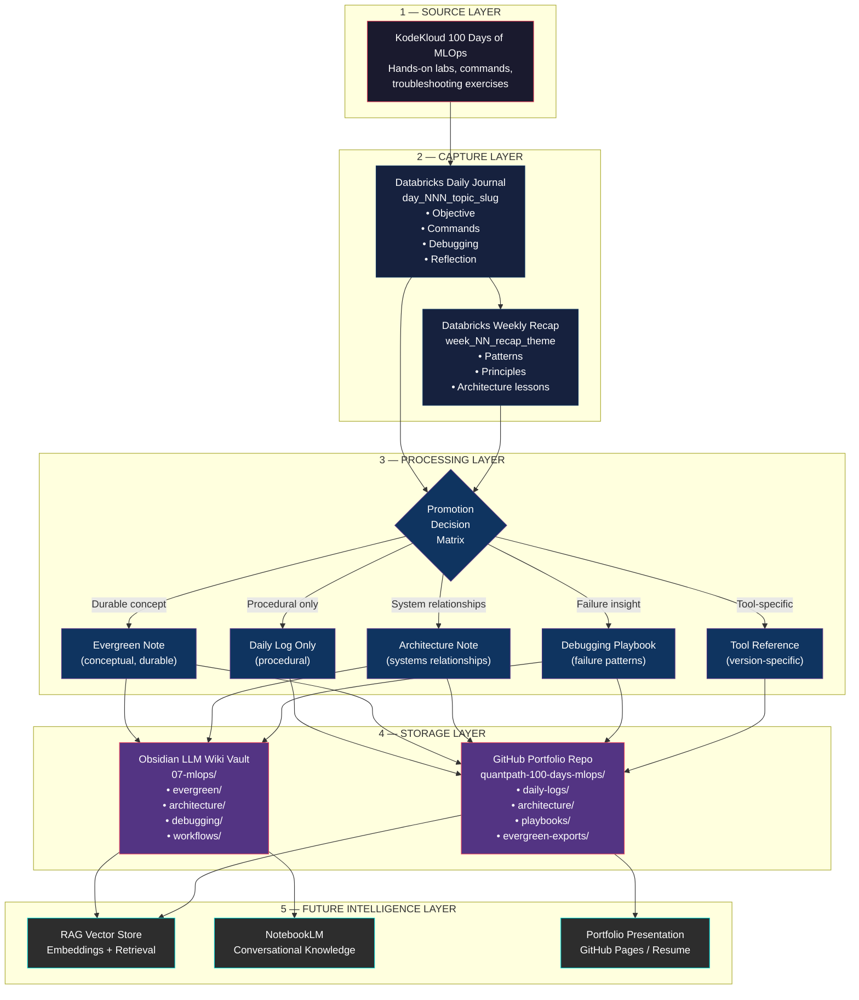

# MLOps Documentation Pipeline

**Purpose**: End-to-end workflow diagram showing how operational learning flows from
KodeKloud tasks through Databricks journals into Obsidian evergreen notes, GitHub
portfolio artifacts, and future RAG ingestion systems.

---

## Pipeline Diagram (Mermaid)





---

## Pipeline Stages Explained

### Stage 1: Source — KodeKloud Platform

**Input**: Daily MLOps tasks from the 100 Days program
**Tools covered**: DVC, MLflow, Feast, Kubernetes, Argo Workflows, Evidently
**Output**: Completed labs, commands executed, configurations created, failures encountered

**Key principle**: KodeKloud provides the *operational stimulus*. It is not the final
destination of learning — it is the trigger for downstream knowledge production.

---

### Stage 2: Capture — Databricks Notebooks

**Input**: KodeKloud task experience (commands, observations, failures, insights)
**Output**: Structured daily journal notebooks + weekly recap notebooks

**Daily cadence** (~20 min):
1. Open Databricks notebook: `day_NNN_topic_slug`
2. Fill template sections during/after KodeKloud task
3. Flag potential promotions (`evergreen_flag`, `portfolio_flag`)
4. Minimum viable entry: Objective + Commands + Reflection

**Weekly cadence** (~30 min):
1. Review all daily notebooks for the week
2. Synthesize patterns, principles, and architecture lessons
3. Identify promotion candidates
4. Generate GitHub commit batch

---

### Stage 3: Processing — Promotion Decisions

**Input**: Flagged daily journals + weekly synthesis
**Decision framework**: [[kodekloud-to-evergreen-conversion]]

**Outputs**:
| Type | Criteria | Destination |
|---|---|---|
| Daily log | Procedural, no transferable insight | GitHub only |
| Evergreen note | Durable concept with failure modes | Obsidian + GitHub |
| Architecture note | Cross-component system relationship | Obsidian + GitHub |
| Debugging playbook | Non-obvious failure with diagnostic value | Obsidian + GitHub |
| Tool reference | Version-specific operational knowledge | GitHub only |

---

### Stage 4: Storage — Dual Persistence

**Obsidian Vault** (private knowledge graph):
- Evergreen notes with full depth and wikilinks
- Architecture notes with system diagrams
- Debugging playbooks with root cause analysis
- Connected via graph links and MOC

**GitHub Repository** (public portfolio):
- Daily logs (all 100 days)
- Selected architecture notes
- Exported evergreen notes (portfolio-safe)
- Playbooks and diagrams
- Weekly recaps

---

### Stage 5: Future Intelligence — RAG and Portfolio

**RAG Vector Store** (planned):
- All `rag_ready: true` vault notes embedded and indexed
- Semantic search over accumulated MLOps knowledge
- Enables conversational querying of learned concepts

**NotebookLM** (planned):
- Vault notes as source material for conversational AI
- Interview preparation tool
- Concept relationship exploration

**Portfolio Presentation** (planned):
- GitHub Pages site from portfolio repo
- Selected architecture notes and diagrams
- Capstone project documentation

---

## Cadence Summary

| Frequency | Action | Time Budget |
|---|---|---|
| Daily | KodeKloud task + Databricks journal | 60-90 min |
| Daily | Flag promotion candidates | 2 min |
| Weekly | Recap notebook + batch promotions | 30-45 min |
| Weekly | GitHub push (daily logs + new artifacts) | 15 min |
| Monthly | MOC update + architecture review | 30 min |
| End of program | Capstone synthesis | Multi-day |

---

## Data Flow Quantities (Expected over 100 Days)

```
KodeKloud Tasks: 100
     │
     ▼
Databricks Daily Journals: 100
Databricks Weekly Recaps: ~15
     │
     ▼
GitHub Daily Logs: 100
Evergreen Notes Created/Updated: 15-25
Architecture Notes: 5-10
Debugging Playbooks: 10-15
Tool References: 6-8
     │
     ▼
RAG-Ready Documents: 40-60
Portfolio Artifacts: 20-30
```

---

## Related Notes

- [[kodekloud-to-evergreen-conversion]] — promotion decision framework
- [[naming-conventions]] — cross-system naming alignment
- [[github-repo-structure]] — portfolio repo architecture
- [[databricks-daily-journal-template]] — daily capture template
- [[databricks-weekly-recap-template]] — weekly synthesis template
- [[vault-practices]] — RAG-readiness and quality standards
- [[moc-mlops]] — MLOps knowledge map
