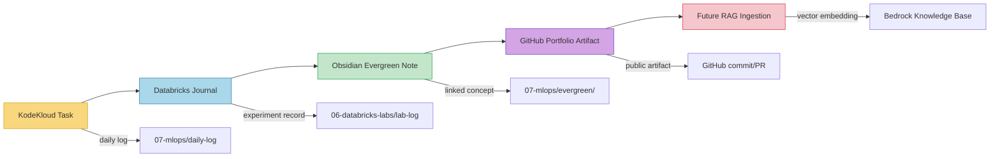

# MLOps Documentation System Plan

**Purpose**: High-level design for the QuantPath MLOps Knowledge Infrastructure documentation system.  
**Status**: 🗓 Planned  
**Last updated**: 2026-05-27  
**Visibility**: PORTFOLIO_SAFE

---

## 1. System Overview

The QuantPath MLOps Knowledge Infrastructure is a four-layer documentation system that transforms daily operational practice into durable, portfolio-ready knowledge assets. Each layer has a distinct role:

| Layer | Platform | Role |
|---|---|---|
| Practice | KodeKloud 100 Days of MLOps | Hands-on task execution and operational skill-building |
| Journal | Databricks Student Edition | Engineering journal — experimentation, code artifacts, reflections |
| Knowledge | Obsidian (this vault) | Evergreen notes, architecture patterns, linked knowledge graph |
| Portfolio | GitHub | Public-facing artifacts, repos, and documentation |

The system is designed so that **raw practice flows upward** through layers of increasing permanence and abstraction — from ephemeral task completion to reusable, RAG-ingestible knowledge.

---

## 2. Four-Layer Workflow

### Layer 1 — KodeKloud Platform (Practice)

**What happens here**: Daily MLOps tasks from the 100 Days of MLOps program. Docker labs, Kubernetes exercises, CI/CD pipelines, monitoring setup, infrastructure provisioning.

**Output**: Completed tasks, screenshots, CLI output, configuration files.

**Disposition rule**: Every completed task produces at minimum a daily log entry. High-signal tasks escalate to higher layers.

---

### Layer 2 — Databricks Journal (Engineering Journal)

**What happens here**: Structured reflection on KodeKloud tasks. Code experiments that extend or test concepts. SQL queries, Python/R scripts, and Spark jobs that connect MLOps concepts to data workflows.

**Output**: Timestamped notebook entries, working code, experiment logs, failure notes.

**Vault location**: `06-databricks-labs/lab-log.md` and related notebooks.

**Disposition rule**: Journals that reveal reusable patterns or non-obvious insights escalate to Obsidian evergreen notes.

---

### Layer 3 — Obsidian Evergreen Notes (Knowledge Graph)

**What happens here**: Distilled, atomic, linked notes that capture durable concepts. Architecture decisions, debugging playbooks, mental models, and cross-domain connections.

**Output**: Notes in `07-mlops/` subfolders — `evergreen/`, `architecture/`, `debugging/`, `playbooks/`, `workflows/`, `infrastructure/`, `glossary/`.

**Navigation**: `01-maps-of-content/moc-mlops.md` serves as the index.

**Disposition rule**: Notes that demonstrate portfolio-level competence or produce reusable artifacts escalate to GitHub.

---

### Layer 4 — GitHub Portfolio Repo (Public Artifacts)

**What happens here**: Polished, portfolio-safe artifacts. README documentation, architecture diagrams, working code samples, and project write-ups.

**Output**: Commits, PRs, project documentation, public-facing repos.

**Repos**: `ChieNwosu/quantpath-llm-wiki` (this vault), plus future dedicated MLOps project repos.

**Disposition rule**: Published artifacts become candidates for future RAG ingestion into a Bedrock Knowledge Base.

---

## 3. Knowledge Flow Diagram



---

## 4. Naming Conventions

All naming follows the vault-wide conventions in `_meta/naming-conventions.md`. MLOps-specific additions:

### Daily Logs

```
07-mlops/daily-log/day-NNN-short-topic.md
```

Example: `day-012-docker-multi-stage-builds.md`

### Evergreen Notes

```
07-mlops/evergreen/concept-name.md
```

Example: `docker-layer-caching.md`, `ci-cd-for-ml.md`

### Architecture Notes

```
07-mlops/architecture/system-or-pattern-name.md
```

Example: `ml-platform-architecture.md`, `model-serving-patterns.md`

### Debugging Playbooks

```
07-mlops/debugging/debugging-failure-description.md
```

Example: `debugging-training-serving-skew.md`, `debugging-pipeline-nondeterminism.md`

### Operational Playbooks

```
07-mlops/playbooks/runbook-action-description.md
```

Example: `runbook-model-rollback.md`, `runbook-drift-investigation.md`

### Databricks Journal Entries

```
06-databricks-labs/lab-log.md  (append-style log)
06-databricks-labs/notebook-name.md  (standalone notebooks)
```

### GitHub Artifacts

```
Repository root or docs/ folder
README.md, architecture diagrams, working code
```

---

## 5. Escalation Criteria

Not every daily task warrants an evergreen note. Use the following decision matrix:

### Daily Log (minimum — every task gets this)

**Criteria**: Task was completed. No special insight required.

**Content**: Date, task number, topic, one-line summary, status.

**Location**: `07-mlops/daily-log/day-NNN-short-topic.md`

---

### Evergreen Note (concept is reusable and linkable)

**Criteria** — promote when ANY of these are true:
- The concept will be referenced by 2+ other notes
- You had to look something up that was non-obvious
- The concept connects two domains (e.g., Docker + ML pipelines)
- You would explain this to someone else as a standalone idea
- The concept has clear failure modes worth documenting

**Location**: `07-mlops/evergreen/`

---

### Architecture Note (system-level design or pattern)

**Criteria** — promote when ANY of these are true:
- The task involved designing or reasoning about a multi-component system
- You made a non-trivial trade-off decision (cost, complexity, latency)
- The pattern applies across multiple projects or environments
- The concept requires a diagram to explain properly

**Location**: `07-mlops/architecture/`

---

### Debugging Playbook (failure → diagnosis → resolution)

**Criteria** — promote when ANY of these are true:
- You spent >15 minutes debugging a non-obvious issue
- The root cause was surprising or counter-intuitive
- The same failure could recur in a different context
- The debugging steps are systematic and reproducible

**Location**: `07-mlops/debugging/`

---

### GitHub Portfolio Artifact (public-facing demonstration)

**Criteria** — promote when ALL of these are true:
- The work demonstrates a marketable skill (MLOps, cloud, data engineering)
- The artifact is self-contained and understandable without vault context
- The code runs or the documentation stands alone
- You would include it in a job application or portfolio review

**Location**: GitHub repository (commit, PR, or dedicated project repo)

---

## Decision Flowchart

```
Task completed
    │
    ├─ Always → Daily log entry
    │
    ├─ Non-obvious concept? → Evergreen note
    │
    ├─ Multi-component system? → Architecture note
    │
    ├─ Surprising failure? → Debugging playbook
    │
    └─ Portfolio-worthy? → GitHub artifact
```

Multiple promotions are possible — a single task can produce a daily log, an evergreen note, AND a GitHub artifact.

---

## Related Files

- [[moc-mlops]] — MLOps knowledge map and navigation hub
- [[naming-conventions]] — Vault-wide naming rules
- [[vault-map]] — Full vault structure reference
- [[rag-readiness-guidelines]] — Preparing notes for future RAG ingestion
- [[obsidian-to-github-workflow]] — Publishing workflow
